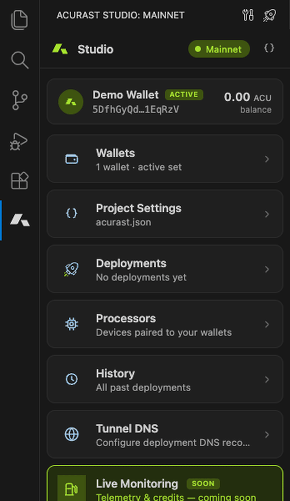

<div align="center">


# Acurast Studio

**Deploy serverless jobs to the Acurast decentralized compute network — without leaving VS Code.**

Manage encrypted wallets, edit `acurast.json`, estimate cost, and deploy to Mainnet or Canary from a single panel. The bundled `@acurast/sdk` handles signing, IPFS upload, and submission — no hand-editing `.env`.

[](https://marketplace.visualstudio.com/items?itemName=dw3labs.acurast-studio)
[](https://marketplace.visualstudio.com/items?itemName=dw3labs.acurast-studio)
[](https://marketplace.visualstudio.com/items?itemName=dw3labs.acurast-studio)
[](./LICENSE)

</div>

<div align="center">



</div>

---

## What is this?

[Acurast](https://acurast.com) is a decentralized serverless compute network built on a Substrate chain. Acurast Studio wraps the [`@acurast/sdk`](https://www.npmjs.com/package/@acurast/sdk) inside VS Code so you can go from script to a live, on-chain job in a few clicks — project scaffolding, wallet creation, IPFS upload, cost estimate, and submission all happen in the editor.

**Who it's for:** developers building and shipping jobs to Acurast who want a guided UI instead of juggling the CLI, raw mnemonics, and `.env` files.

## Features

### Studio panel

- 🧰 **All-in-one activity-bar view** — Home, Wallets, Project Settings, Deploy, Processors, History, and Tunnel DNS in one panel, no CLI required.
- 🪄 **Project scaffolding** — **`Acurast: Init Project`** is a native wizard: pick the runtime (Node.js or Shell), the schedule, and — for Shell — the rootfs image, and it writes `acurast.json`, a starter entrypoint, and a README for you.
- 🔐 **Encrypted wallet vault** — create, import, rename, and delete sr25519 wallets. Mnemonics are encrypted at rest with **AES-256-GCM + PBKDF2 (210k iterations)** *inside* VS Code's SecretStorage, so even a keychain dump still needs your password.
- 📊 **Live balance** — wallet balance refreshes every 30 seconds while you're on the Wallets view.

### Deploying

- 🚀 **One-click deploy** — packages your script, uploads it to IPFS, and submits the job to Mainnet or Canary, with a live stage-by-stage progress view.
- 🔨 **Project build step** — declare a `build` block in `acurast.json` (`command`, `cwd`, `output`) and Studio runs your toolchain — cargo, make, a bundler, anything — before deploy, or on demand via **`Acurast: Build`**. Requires a trusted workspace.
- ✅ **Pre-deploy validation** — blocking schema errors and non-blocking advisories (missing Shell `image`, a start time inside the unsafe window, `onlyAttestedDevices: false`, too-tight interval timing) surfaced before you spend anything.
- 💸 **Cost estimation** — preview ACU spend before you deploy, with optional fiat conversion (CoinGecko / CoinMarketCap) and cached exchange rates.
- 🐧 **Shell runtime image catalog** — Shell deploys need a proot-distro rootfs URL *and* its SHA256. Pick both from a dropdown in Project Settings instead of hand-copying them, and refresh the catalog from upstream on demand (aarch64 only — Acurast processors are Android ARM64 devices).
- ⏱️ **Duration converter** — type `2h 30m` and get milliseconds, from the clock buttons next to every ms field or the **`Convert Duration to Milliseconds`** command.

### After deploy

- 📜 **Deployment history** — a persistent, cross-workspace log of every deploy: project path, tx hash, IPFS hash, and job IDs.
- 🔗 **On-chain history** — fetch your live job registrations straight from the chain, with schedule, slots, reward, required modules, assignments, an expiry countdown for running jobs, and a derived status (active / scheduled / expired).
- 🩺 **Job diagnosis** — when a deployment isn't matching or running, run an on-chain diagnosis that checks processor version, requirements, and assignment state and tells you why.
- 🗑️ **Deregister & bulk cleanup** — deleting a record removes it locally *and* signs an on-chain deregister when the job is still registered. Multi-select several at once and they're batched into a single `utility.forceBatch` per network.

### Beyond deploys

- 🖥️ **Processors** — inspect the processors your wallet manages, edit their advertised modules (`DataEncryption`, `LLM`, `Shell`), and put a never-advertised processor on the marketplace with a guided "Start advertising" flow.
- 🌐 **Tunnel DNS** — a three-step wizard (configure → records → verify) that derives the DNS records for exposing a deployment over the Acurast tunnel on your own domain, then verifies they resolve.
- ✍️ **First-class `acurast.json`** — a dedicated `acurast-config` language with schema-driven completion, hover docs, live diagnostics, syntax highlighting, and its own file icon. Multi-config workspaces are supported, with a right-click **"Set as Active acurast.json"**.
- ⚠️ **Network-mismatch guard** — the status bar and Deploy/Settings views warn (with a one-click fix) when the network you're monitoring differs from the one your project deploys to.
- 🛡️ **Workspace-trust aware** — build commands, the CLI path, and custom RPC/matcher/relay endpoints are all restricted in untrusted workspaces.

## Coming soon

- 📡 **Live monitoring** — stream logs and runtime metrics from your running jobs directly in the editor.

## Getting started

1. **Install** Acurast Studio from the Marketplace.
2. **Open a workspace** that contains an `acurast.json` — or run **`Acurast: Init Project`** to scaffold one from scratch (no external CLI needed).
3. Click the **Acurast logo** in the activity bar to open the Studio panel.
4. **Create or import a wallet**, fund it, then hit **Deploy**.

> The extension auto-activates as soon as a workspace contains an `acurast.json`.

## Configuration

| Setting | Default | Description |
|---|---|---|
| `acurast.network` | `mainnet` | Studio target network (`mainnet` or `canary`) for balance, processors, on-chain history, and the status bar |
| `acurast.rpcOverrides` | `{}` | Custom RPC endpoints per network, e.g. `{ "mainnet": "wss://my-rpc.example.com" }` |
| `acurast.matcherUrls` | `{}` | Custom matcher API endpoints per network |
| `acurast.tunnelRelays` | `{}` | Custom tunnel relay node IPs per network for the Tunnel DNS wizard. Replaces the built-in defaults for that network |
| `acurast.useKeychainForMnemonic` | `true` | Store the encrypted mnemonic in the OS keychain |
| `acurast.fiat.exchangerId` | `2` | Pricing source for cost estimates — `1` CoinMarketCap, `2` CoinGecko |
| `acurast.fiat.currencyId` | `""` | Fiat currency id (e.g. `usd`). Pick it from the Settings panel; blank disables fiat conversion |
| `acurast.fiat.coingecko.plan` | `demo` | CoinGecko plan tier (`demo` or `pro`) matching your API key |
| `acurast.cliPath` | `acurast` | Path to the `acurast` CLI binary. Only used by the **Open devtools** action on a running job — scaffolding, deploy, cost estimate, and wallets all use the bundled SDK. Machine-scoped, so a workspace can't point it at another executable |

> **Note:** `acurast.network` sets the network you *monitor* (balance, processors, history, status bar). Deploys always use the `network` field in your `acurast.json`. If the two differ, Acurast Studio shows a one-click prompt to align them.

## Commands

All commands live under the **`Acurast`** category in the Command Palette (`Cmd/Ctrl+Shift+P`).

| Command | Description |
|---|---|
| Acurast: Init Project | Scaffold a new project — runtime, schedule, image, `acurast.json`, and starter files |
| Acurast: Deploy | Deploy the active job to the network |
| Acurast: Build | Run the project's `build` command without deploying |
| Acurast: Estimate Cost | Preview ACU cost before deploying |
| Acurast: Project Settings | Open the project configuration view |
| Acurast: Configure Tunnel DNS | Open the Tunnel DNS wizard |
| Acurast: Convert Duration to Milliseconds | Turn `2h 30m` into ms and copy it |
| Acurast: Choose acurast.json… | Switch the active config in a multi-config workspace |
| Acurast: Clear Active acurast.json | Forget the selected config |
| Acurast: Go to Home | Jump back to the Studio home view |
| Acurast: Create Wallet | Generate a new sr25519 wallet |
| Acurast: Import Wallet | Import a wallet by mnemonic |
| Acurast: Reveal Mnemonic | Decrypt and show a wallet's mnemonic |
| Acurast: Rename Wallet | Rename a wallet |
| Acurast: Open Dashboard | Open the Acurast web dashboard |

*(Additional wallet commands — copy address, set active, delete, edit description — are available under the same category. **Set as Active acurast.json** is a right-click action in the explorer and editor rather than a palette command, since it needs a file.)*

## Requirements

- **VS Code 1.120** or newer
- A workspace containing an `acurast.json` file (use **`Acurast: Init Project`** if you don't have one yet)

## Security

Your seed phrase never leaves your machine in plaintext. Each mnemonic is encrypted with **AES-256-GCM**, keyed by **PBKDF2-SHA256 (210,000 iterations, OWASP 2023 guidance)**, and the ciphertext is what's stored in VS Code SecretStorage. Revealing a mnemonic always requires your password.

Acurast Studio also respects [Workspace Trust](https://code.visualstudio.com/docs/editor/workspace-trust). Wallets, balance, and history work anywhere; a project's `build.command` runs an arbitrary shell command and is refused in untrusted workspaces; and the settings that pick a host executable or redirect a network endpoint (`acurast.cliPath`, `acurast.rpcOverrides`, `acurast.matcherUrls`, `acurast.tunnelRelays`) can't be overridden by an untrusted workspace.

## Links

- 🌐 [Acurast website](https://acurast.com)
- 📦 [`@acurast/sdk` on npm](https://www.npmjs.com/package/@acurast/sdk)
- 🐙 [Source & issues on GitHub](https://github.com/darwinsubramaniam/acurast-studio)

## ❤️ Support development

Acurast Studio is built and maintained independently. If it saves you time, a small donation directly funds new features and ongoing maintenance. 🙏

| Network | Address |
|---|---|
| **ACU** (Acurast) | `5EqCVoSXfLwwEj7zxWvmCMvmiVXZSgeHTj5anpm4sAN6SgXp` |
| **DOT** (Polkadot) | `13mVe8hbX8DQgG8Wv9ymLWkva7XD8zCRYDp4x7kRRFPcd4ei` |

Prefer to connect a wallet? Use the **[donation page](https://darwinsubramaniam.github.io/acurast-studio-donate/)** — a non-custodial page to send ACU or DOT straight from Polkadot.js / Talisman / SubWallet. You can open it (or copy the addresses) from the **Home** panel in the extension too.

## Contributing

Issues and pull requests are welcome — see the [repository](https://github.com/darwinsubramaniam/acurast-studio).

<details>
<summary>Local development</summary>

```bash
npm install
npm run build:dev   # build extension + webview with sourcemaps
npm run watch       # watch both bundles in parallel
npm run typecheck   # type-check without emitting
npm test            # unit + integration tests
```

Press **F5** in VS Code to launch the Extension Development Host. After code changes, **Cmd+R** reloads the host (webviews don't hot-reload).

Two bundles are produced: `dist/extension.js` (Node/CJS host) and `dist/studio/webview.js` (Svelte 5 webview).

</details>

## License

[MIT](./LICENSE)
